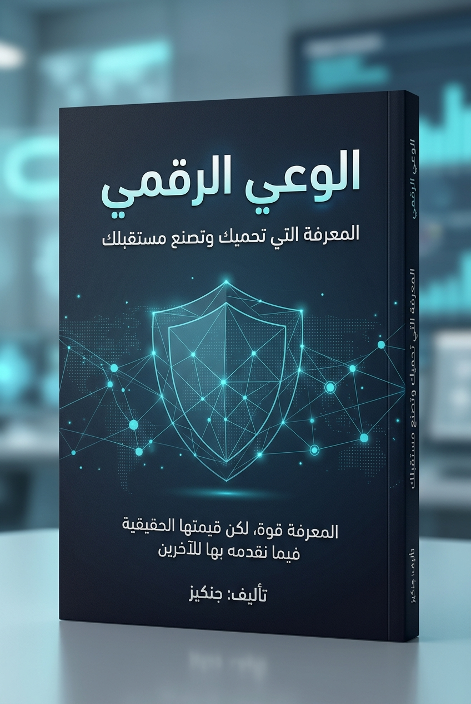

# الوعي الرقمي: المعرفة التي تحميك وتصنع مستقبلك
## تأليف: جنكيز

> **«المعرفة قوة، لكن قيمتها الحقيقية تتجلّى في نفع الآخرين بها».**

---

  

---

### عن الكتاب
كتاب عربي تقني، علمي، وتوعوي أصيل يهدف إلى نشر المعرفة التقنية النافعة وتمكين جميع فئات المجتمع من فهم التكنولوجيا الحديثة وحماية أنفسهم وعائلاتهم في الفضاء الرقمي، والارتقاء بمهارات التفكير المنطقي والبرمجي المسؤول.

* **المؤلف:** جنكيز
* **نوع الكتاب:** علمي، تقني، تعليمي، توعوي، وثقافي
* **الحجم المستهدف:** 140 صفحة تقريباً (120–150 صفحة)
* **المجالات:** البرمجة (Python)، الأمن السيبراني الدفاعي، الذكاء الاصطناعي، الخصوصية الرقمية، وتكنولوجيا خدمة المجتمع.

---

### فهرس فصول الكتاب
1. **[الصفحات التمهيدية](00_front_matter.md):** كلمة المؤلف «جنكيز»، حقوق النشر، الإهداء، والمقدمة المنهجية.
2. **الفصل الأول:** الإنسان في العصر الرقمي (بنية الإنترنت، رحلة البيانات، DNS، والخوادم).
3. **الفصل الثاني:** كيف تعمل البرامج والتطبيقات؟ (أنظمة التشغيل، الويب، التطبيقات، الخوادم، وAPIs).
4. **الفصل الثالث:** البرمجة وفن التفكير المنطقي (الخوارزميات، لغة بايثون، ومشروع عملي آمن).
5. **الفصل الرابع:** الأمن السيبراني وفهم المخاطر الرقمية (ثالوث CIA، نماذج التهديد، والهندسة الاجتماعية).
6. **الفصل الخامس:** كيف تحمي نفسك وعائلتك رقمياً؟ (الدليل الدفاعي التطبيقي وقائمة فحص من 20 نقطة).
7. **الفصل السادس:** بناء البرمجيات والأنظمة الآمنة (معايير OWASP وNIST، التشفير، ودوال التجزئة).
8. **الفصل السابع:** الذكاء الاصطناعي ومستقبل الإنسان (النماذج اللغوية، الهلوسة، الخصوصية، والمهارات الإنسانية).
9. **الفصل الثامن:** أخطاء رقمية قد تغير حياتك (دراسة سيناريوهات واقعية وطرق التعافي الفوري).
10. **الفصل التاسع:** التكنولوجيا في خدمة المجتمع (البرمجيات الإنسانية، إتاحة الويب، والتطوع التقني).
11. **الفصل العاشر:** من المعرفة إلى التأثير (خطة الـ 30 يوماً لرفع الوعي الرقمي والأمان الشخصي).
12. **الخاتمة ومعجم المصطلحات التقنية وقائمة المراجع الرسمية المعتمدة.**

---

### خريطة التطوير والتوثيق
يمكن متابعة تفاصيل التوزيع الهندسي للصفحات والكلمات والأهداف التفصيلية لكل فصل عبر:
* [وثيقة الخطة الشاملة للكتاب](book_master_plan.md)

---
© 2026 جنكيز — جميع الحقوق محفوظة للمؤلف.
